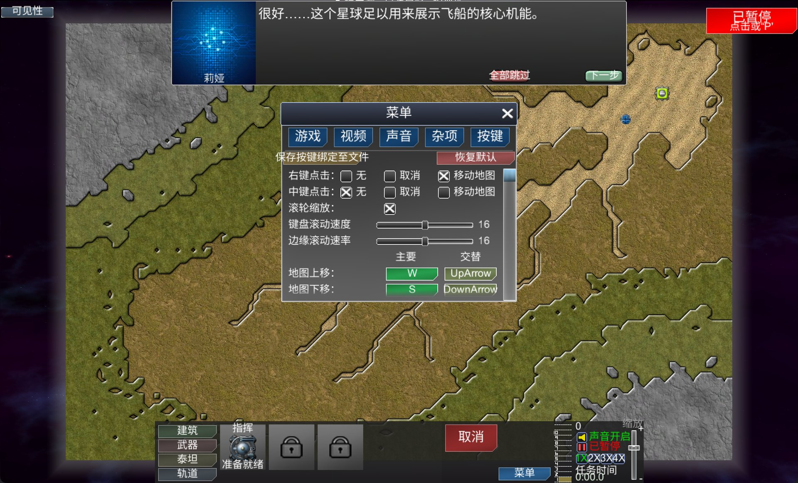

# Creeper World 3 简体中文补丁

面向 **Windows 与原生 macOS 的 Steam 2.12 / build 22453699**，主要菜单、剧情和教程纯离线汉化。社区内容和地图编辑器可能保留英文。

## 下载与安装

从 [Release](https://github.com/m1m0ry/cw3-localization-public/releases/latest) 下载对应平台的补丁包。解压补丁包。须自备上述版本的正版游戏。

### Windows

1. 完全退出游戏。
2. 在 Steam 中右键游戏 → 管理 → 浏览本地文件。
3. 将 `CW3_Data` 和 `CW3Localization` 复制到游戏安装文件夹（`CW3.exe` 所在位置），提示时选择覆盖。

**手动安装无需 Python。** 更新时保留原有 `CW3Localization` 中的 `fonts/`、`text-style.json` 和 `zh-CN.user.json`，只合并包内文件。

也可安装 Python 3.10+ 后双击包内 `安装汉化.cmd`，按提示选择游戏安装文件夹，再选 `1 安装/重装汉化`。

CrossOver 使用同一 Windows 包，运行 `安装汉化.command`，选择包含 `CW3.exe` 的游戏安装文件夹。

### 原生 macOS

1. 完全退出游戏。
2. 安装 Python 3.10+。
3. 在 Steam 中右键游戏 → 管理 → 浏览本地文件，找到包含 `CW3.app` 的目录。
4. 双击包内 `安装汉化.command`，按提示选择该目录，再选 `1 安装/重装汉化`。

如系统阻止启动，确认来源后按系统提示手动允许。

### 恢复原版

运行对应的安装脚本，选择 `2 清理汉化程序`，再通过 Steam「验证游戏文件完整性」。

## 自定义译文

以下文件位于游戏目录的 `CW3Localization` 中：

- `zh-CN.default.json`：随补丁更新的默认译文。
- `zh-CN.user.json`：可选的自定义译文；有效条目优先于默认译文，安装时保留。

从默认文件复制要修改的条目到用户文件，沿用 `format`、`language`、`entries` 格式，只保留自定义项。仅改 `translation`，保留 ID、原文、标签和占位符；退出游戏后修改，重启生效。

## 译文与构建

译文统一维护在 `translations/zh-CN.json`。仅修改 `translation`，保留原文、目标、标签和占位符；检查无需游戏文件或翻译服务：

```sh
python3 tools/workflow.py check
```

源码构建需自备匹配游戏文件及构建依赖，见[构建文档](docs/build.md)。

## 游戏截图

中文主菜单。


序幕文字。


莉娅对话与按键设置。



自写代码采用 [MIT](LICENSE)，字体采用 [OFL 1.1](fonts/OFL.txt)。游戏原文、画面及资源不属于本项目的 MIT 授权范围，见 [NOTICE](NOTICE.md)。

[贡献译文](CONTRIBUTING.md) · [构建与安装](docs/build.md) · [字体与字号](docs/text-style.md) · [字体与第三方许可](docs/licensing.md)
